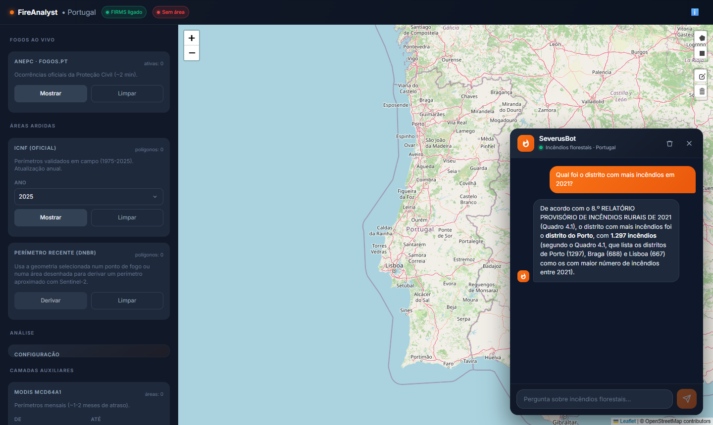
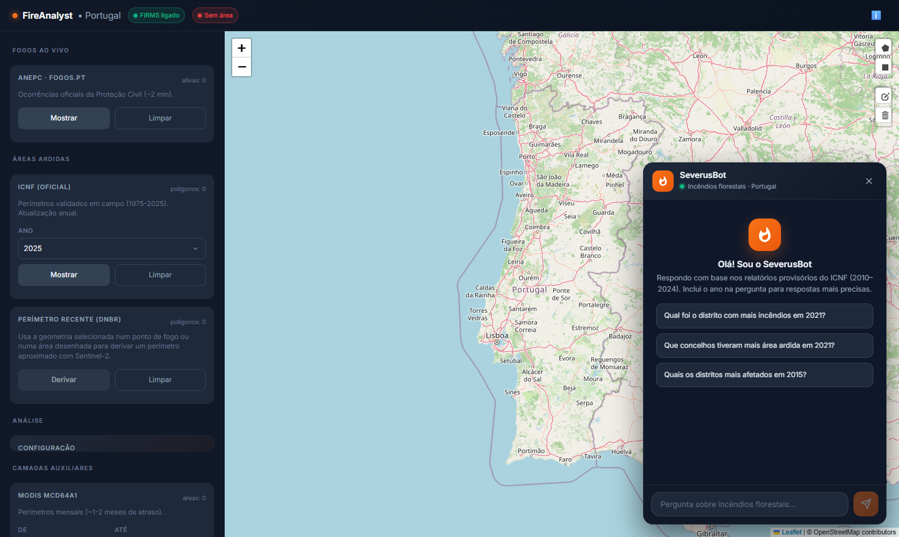

# FireAnalyst · SeverusPT

**▶ Live demo: [proj4-severuspt.onrender.com](https://proj4-severuspt.onrender.com)** *(free Render instance — the first load can take ~30 s to wake up)*

A web app for analysing wildfires in Portugal. Draw an area on the map, pick a satellite and a date range, and FireAnalyst computes burn-severity maps and vegetation time series on Google Earth Engine. A RAG-powered chatbot answers questions about Portuguese wildfire data.

**Stack:** React · TypeScript · Vite · Express · Google Earth Engine · Leaflet · Chart.js · OpenRouter LLMs · FAISS retrieval (`rag-vector-lab`)

## 📸 Screenshots

**SeverusBot** answering from the ICNF reports (retrieval by `rag-vector-lab`):



<details>
<summary>Chat welcome screen with suggested questions</summary>



</details>

## 🚀 Features

- **Interactive Map**: Draw polygons/rectangles to select areas of interest
- **Burn Severity Analysis**: Calculate dNBR, RdNBR, RBR and classified severity maps
- **Time Series Analysis**: Plot NDVI/NBR trends over time
- **Multi-satellite Support**: Sentinel-2, Landsat 5/7/8/9, MODIS, HLS
- **Recent Perimeter (dNBR)**: Derive an approximate burned perimeter from Sentinel-2 around a fire date
- **RAG-powered Chat (SeverusBot)**: Ask questions about the ICNF provisional wildfire reports (2010–2024). Retrieval uses FAISS vector search from the [`rag-vector-lab`](rag-vector-lab) submodule
- **Burned Area Datasets**: ICNF and EFFIS historical data

## 📋 Prerequisites

- Node.js 18+ and npm
- [`uv`](https://docs.astral.sh/uv/) (installs the pinned Python 3.12 and the chat's retrieval dependencies automatically)
- OpenRouter API key (for chat answers)
- Google Earth Engine service account credentials (optional; needed for MODIS and Sentinel-2 analyses)

## 🔧 Setup

### 1. Clone with the submodule

The chat's retrieval lives in the `rag-vector-lab` git submodule.

```bash
git clone --recurse-submodules <repo-url>
# already cloned without it?
git submodule update --init
```

### 2. Install dependencies

```bash
npm install
```

### 3. Configure credentials

```bash
cp .env.example .env
```

Edit `.env`:

```bash
DP_API_KEY=your_openrouter_api_key     # required for the chat
# OPENROUTER_MODEL=openrouter/free      # optional; default is openrouter/free
GEE_PRIVATE_KEY='{"type":"service_account","project_id":"..."}'   # optional, see below
```

GEE credentials (optional) can be given in one of two ways:

- **Environment variable**: set `GEE_PRIVATE_KEY` in `.env` (recommended for production)
- **JSON file** (development): place the service account file at `src/lib/config/<your-service-account>.json`

Without GEE credentials the app still runs; MODIS and Sentinel-2 analyses are disabled and the sidebar says so.

⚠️ **Security Note**: Never commit `*.json` credential files or `.env` to git (both are in `.gitignore`).

### 4. Build the chat's search index (once)

The chat answers from 15 ICNF reports. This step reads the PDFs, embeds them (downloads two Hugging Face models on the first run) and builds the FAISS indexes. It takes a few minutes and is only needed once per machine.

```bash
cd rag-vector-lab
uv sync
uv run ragvl ingest
uv run ragvl build
cd ..
```

This creates `rag-vector-lab/cache/` and `rag-vector-lab/indexes/` (both git-ignored).

### 5. Run the application

The chat needs **two processes** besides the app's own build, so use two terminals.

**Terminal 1 – retrieval service** (loads the model and index; takes ~20 s to start):
```bash
npm run rag:service
```

**Terminal 2 – app** (Express serves the built frontend and the API):
```bash
npm run build     # only needed after changing frontend code
npm start
```

Open http://localhost:3000 and use the chat widget in the corner.

For frontend development, run `npm run dev` (Vite, port 5173) next to `npm start`.

If you do not need the chat you can skip Terminal 1 and step 4; everything else works and the chat just answers from the model's general knowledge.

## 🤖 How the chat works

1. The widget sends the conversation to `POST /api/chat`.
2. `chat.js` asks the retrieval service (`services/ragvl_server.py`, port 8765) for the 5 most relevant report excerpts.
3. If the question names a year (e.g. "em 2021"), only that year's report is searched, because the reports are near-identical and numbers from different years would otherwise get mixed. Two years (comparisons) take the best excerpts from each. With no year, all reports are searched.
4. The excerpts go to OpenRouter as context and the model writes the answer.

Tips for good answers: always include the year in the question. Data in the reports covers 1 January to ~15 October and is provisional. The three large PDFs in `public/docs` (2024 burned-area analysis, SGIFR report, SeverusPT manual) are **not** in the index.

Retrieval quality was measured in `rag-vector-lab` (recall@5 ≈ 0.61 on 36 questions), so some questions will miss; check important figures against the source report.

Optional settings for the retrieval service (environment variables): `RAGVL_PORT` (default 8765), `RAGVL_MODEL` (`e5-small` or `minilm`), `RAGVL_INDEX` (`hnsw`, `flat` or `numpy`). The backend reads `RAGVL_URL` (default `http://127.0.0.1:8765`).

## 📁 Project Structure

```
src/
├── api/
│   └── routes/          # Express API routers
│       ├── chat.js      # Chat: retrieval service + OpenRouter
│       ├── gee.js       # Google Earth Engine endpoints
│       ├── icnf.js, firms.js, fogos.js
│       └── rag.js       # Legacy TypeScript embeddings (not used by the chat)
├── components/          # React components
│   ├── map/            # Leaflet map components
│   ├── analyst/        # Analysis tools
│   ├── charts/         # Chart.js visualizations
│   └── ChatBot/        # Chat widget (markdown rendering)
├── pages/
│   └── Home.tsx        # Main application page
├── lib/
│   ├── services/       # Backend services (GEE)
│   ├── rag/            # Legacy TS RAG pipeline (superseded by rag-vector-lab)
│   └── utils/          # GEE authentication
└── main.tsx           # React entry point

services/
└── ragvl_server.py    # HTTP wrapper over rag-vector-lab (search + year filter)

rag-vector-lab/        # Git submodule: FAISS retrieval + evaluation harness (Python)
scripts/gee/           # Earth Engine Code Editor monitoring script
server.js              # Express server
```

## 🌐 API Endpoints

### GEE Operations
- `GET /api/gee/status` - Whether GEE credentials are configured
- `GET /api/gee/modis-burned-areas` - MODIS MCD64A1 burned-area polygons
- `POST /api/gee/derive-perimeter` - Sentinel-2 dNBR perimeter from a geometry and fire date
- `POST /api/gee/time-series` - Get NDVI/NBR time series
- `POST /api/gee/severity-maps` - Generate burn severity maps
- `POST /api/gee/severity` - Calculate severity evolution
- `POST /api/gee/severity-stats` - Get severity class statistics
- `POST /api/gee/image-list` - List available satellite images

### Chat
- `POST /api/chat` - Send a conversation to the chatbot (returns `reply`, `ragStatus`, `sources`)

### Retrieval service (port 8765, internal)
- `GET /health` - Chunk count, model and index in use
- `POST /search` - `{"query": "...", "k": 5}`

## 🎯 Usage

1. **Select Mode**: Choose between "Mapper" (severity maps) or "Analyst" (time series)
2. **Define Area**: Draw a polygon or rectangle on the map
3. **Configure Dates**: Set pre/post fire dates or use fire date + window
4. **Select Satellite**: Choose from available satellites
5. **Generate Analysis**: Click "Generate Maps" or "Plot Time Series"
6. **Explore Results**: View interactive maps and charts

## 🔨 Development Commands

```bash
npm run dev          # Start Vite dev server (port 5173)
npm run build        # Build production bundle
npm start            # Start Express server (port 3000)
npm run rag:service  # Start the chat retrieval service (port 8765)
```

## 🚢 Deployment

### Environment Variables for Production

```bash
DP_API_KEY=your_openrouter_key
GEE_PRIVATE_KEY='{"type":"service_account",...}'
PORT=3000
NODE_ENV=production
# Chat retrieval service, if it runs on another host/port:
# RAGVL_URL=http://127.0.0.1:8765
```

### Deploy to Render/Railway/Vercel

1. Build the app: `npm run build`
2. Set environment variables in your hosting platform
3. Start command: `npm start`
4. Ensure the `dist/` folder is served

The chat's retrieval service is a separate Python process. To have RAG in production, run `services/ragvl_server.py` alongside the app (same host, or elsewhere with `RAGVL_URL` set) with the search index built. Serverless platforms such as Vercel cannot run it; without it the chat still answers, but only from the model's general knowledge.

## 📚 Technologies

- **Frontend**: React 18, TypeScript, Vite, React Router, react-markdown
- **Backend**: Express 4, Node.js
- **Retrieval**: Python 3.12, FAISS, sentence-transformers (`multilingual-e5-small`)
- **Mapping**: Leaflet, Leaflet Draw
- **Charts**: Chart.js, ApexCharts
- **AI**: OpenRouter API
- **Geospatial**: Google Earth Engine
- **Styling**: CSS, custom styles

## 🐛 Troubleshooting

**Map not rendering?**
- Check browser console for Leaflet errors
- Ensure CSS is properly loaded
- Verify `dist/` has the built assets (run `npm run build`)

**GEE authentication failed?**
- Verify credentials JSON is valid
- Check the file path: `src/lib/config/<your-service-account>.json`
- Or set `GEE_PRIVATE_KEY` environment variable

**Chat shows "Ocorreu um erro"?**
- Look at the `npm start` terminal. `OpenRouter API error: Unauthorized` means `DP_API_KEY` is missing or invalid; remember to restart `npm start` after editing `.env`
- `OpenRouter API error: Not Found` means the model no longer exists; set `OPENROUTER_MODEL` in `.env`
- `Erro/Timeout RAG` means the retrieval service is not running; start `npm run rag:service`

**Chat answers without citing the reports?**
- Check the service is up: `curl http://127.0.0.1:8765/health`
- If it fails with a missing file error, build the index (step 4)
- Include the year in your question

**`rag:service` fails to start?**
- Make sure the submodule is present (`git submodule update --init`) and `uv` is installed
- Re-run `uv sync`, `uv run ragvl ingest` and `uv run ragvl build` inside `rag-vector-lab`
